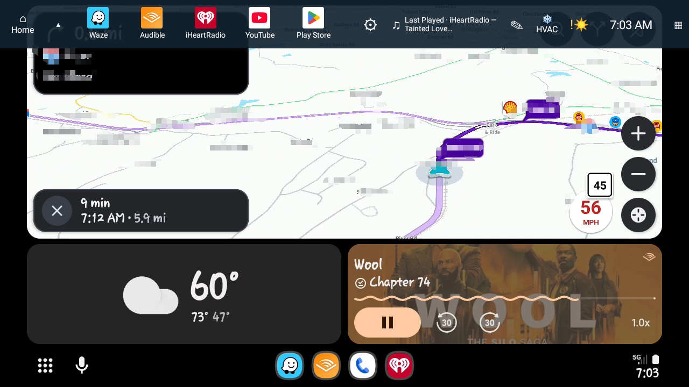
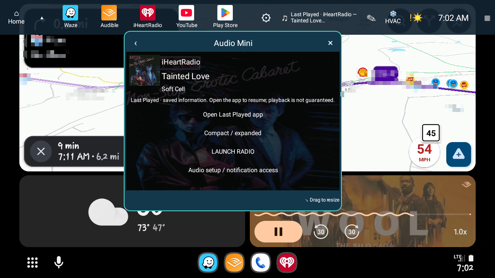
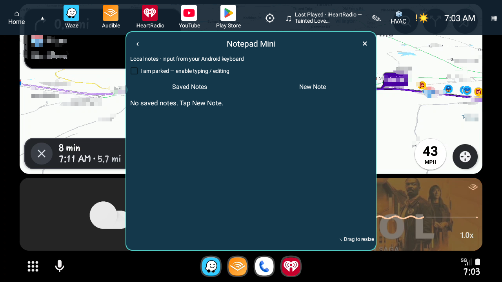
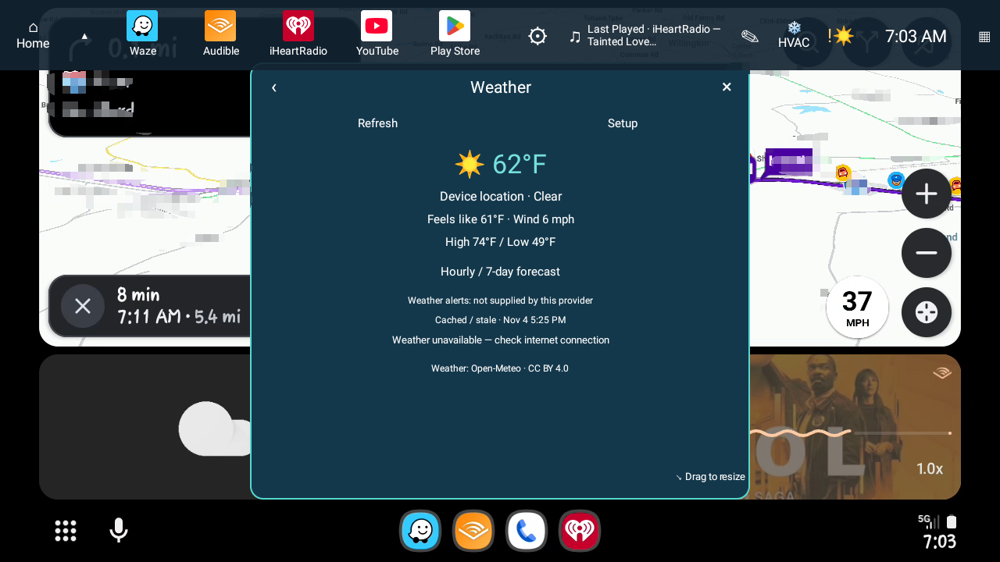
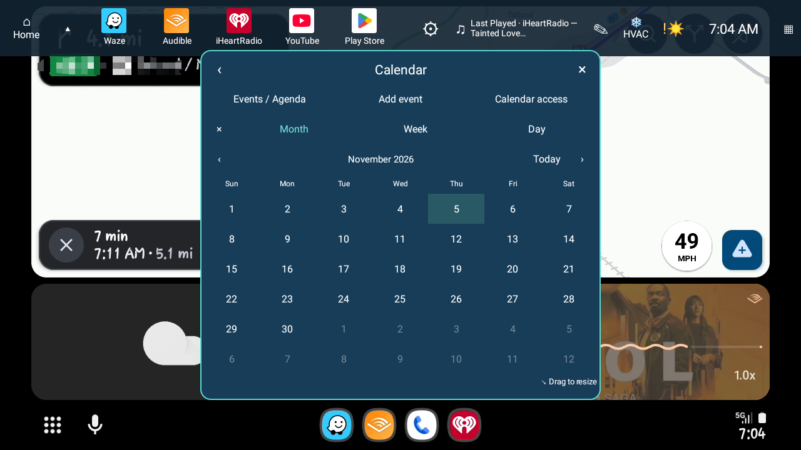

# DashHopper 🐸

**Your apps, just a hop away.**

DashHopper is a configurable, persistent quick-access dock for compatible Android aftermarket head units. It stays available above supported native apps and Android Auto receiver software, making it easy to open installed apps and compact utilities without replacing the vehicle's existing launcher.

> **Status: 2.1.2 beta candidate.** The beta APK will appear under Releases after approval. Compatibility is device-dependent; features described below are not guaranteed on every head unit.

## What DashHopper does

- **Persistent dock:** Place the dock at the top, bottom, left, or right edge; drag it, collapse it to a small handle, and configure appearance and automatic collapse.
- **App shortcuts:** Pin, remove, reorder, and launch installed Android applications. A Settings gear opens dock configuration; the dock can start without forcing the Settings screen to appear.
- **Configurable utilities:** Show or hide built-in Weather, Calendar, Audio Mini, and Notepad Mini, plus an HVAC quick-control shortcut when a compatible provider is selected.
- **Floating toolboxes:** Open movable, resizable Weather, Calendar, Audio Mini, and Notepad Mini windows. These are DashHopper-owned utilities; they are not general-purpose containers for arbitrary third-party apps.
- **Audio Mini:** Display supported local Android media sessions, artwork and metadata, and available playback controls. A labeled **Last Played** record can retain the most recent source when its media session disappears, with an **Open Last Played app** action. It does **not** guarantee automatic playback, track/station restoration, or support for phone audio projected through Android Auto.
- **Notepad Mini:** Create, edit, review, and delete short notes stored locally. Text entry uses the installed Android keyboard, including that keyboard's microphone/dictation option if available. Editing requires an **I am parked** confirmation; this is not a verified driving-state sensor. Notes are explicitly saved, not automatically saved after speech silence.
- **Weather:** Local weather and forecast views with cached/stale information clearly identified when connectivity is unavailable.
- **Calendar:** Month, week, day, and agenda views, with calendar-event access when permissions allow.

## Optional third-party HVAC integration

DashHopper supports a public quick-control launch action:

`org.dashhop.intent.action.HVAC_QUICK_CONTROL`

It discovers a selected installed HVAC app's compatible exported Activity and launches that app's own mini interface. **TempTango** is an independent example of this approach; DashHopper does not bundle TempTango, send HVAC commands, or access vehicle CANBUS.

If no compatible provider is selected and available, users need not display the HVAC shortcut.

## Tested environment and limitations

Development and field testing have focused on an Android 11 aftermarket head unit (Qualcomm SM4250, 1280 × 720 landscape, XYAuto-style firmware).

Earlier development builds demonstrated dock access over wireless Android Auto and standalone Waze, and launch and dismissal of an external HVAC mini Activity. Those results apply to the earlier builds and their tested firmware.

The project owner installed and tested 2.1.2 on the Android 11 head unit and confirmed that the app, including Notepad Mini, works satisfactorily for this beta. The automated audit separately verified the build, signing certificate and 2,246 host assertions. Retention of saved Notepad Mini notes across a subsequent APK update remains unverified. Keyboard dictation, media-session restoration and ACC or reboot behavior can vary with the head unit.

The APK declares Android 8.0 (API 26) as its minimum and targets Android 11 (API 30). Android 11 is the primary field test platform. Other releases, firmware and portrait layouts need device verification.

Important limitations:

- Requires an Android head unit that permits installing ordinary Android APKs and granting overlay access. Merely supporting Android Auto or CarPlay does **not** mean a factory head unit can run DashHopper.
- Overlay behavior and permission handling vary by Android version, firmware, and app. Some protected surfaces may not permit overlays.
- Weather needs an available internet connection for fresh updates; some Android Auto receiver configurations disable or repurpose head-unit Wi-Fi.
- Local media-session monitoring requires appropriate Android notification access. Not all audio apps expose usable sessions or controls.
- Notepad dictation availability, offline operation, and audio interruptions are controlled by the installed keyboard and its speech provider.
- DashHopper does not act as a full HOME launcher, embed arbitrary apps in resizable windows, operate a phone companion, or implement OBD/CANBUS communication.

## Screenshots

DashHopper 2.1.2 beta candidate running over Android Auto on an Android 11 aftermarket head unit. Selected navigation details have been obscured. The captures show the dock and toolboxes on the primary Android 11 test platform.

### Persistent dock over Android Auto

### Audio Mini — Last Played

### Notepad Mini

### Weather

Weather data by [Open-Meteo](https://open-meteo.com/), [CC BY 4.0](https://creativecommons.org/licenses/by/4.0/). Values are shown in Fahrenheit.

### Calendar

## Safety

Configure the dock, edit notes, test features, and review diagnostic information **while safely parked**. Do not use controls or watch content that diverts attention from driving. A user-selected parked checkbox is not proof that the vehicle is stationary. Check overlay behavior with the reverse camera and incoming calls while safely parked. Firmware controls which surfaces take priority.

## Beta downloads

There is **no published beta download yet**. When an approved, verified APK is available, it will appear under [Releases](../../releases), with version information, release notes, and a SHA-256 checksum. Do not treat an in-development build or screenshot as a published release.

Keep your existing launcher installed. Install the official APK over an existing DashHopper installation signed by the same developer to retain app data. For instructions, optional permissions and troubleshooting, see [Installation and setup](docs/INSTALL.md). For a local build without private signing credentials, see [Building from source](docs/BUILD.md).

## Feedback and diagnostics

Report problems using [GitHub Issues](../../issues/new/choose), including the DashHopper version, Android/head-unit details, reproduction steps, and sanitized diagnostic logs where possible.

DashHopper uses an app-generated, persistent random diagnostic device identifier for correlating reports; it is not a VIN, IMEI, or hardware serial. Treat logs as potentially sensitive and remove personal details, locations/routes, contacts, tokens and other private information before sharing them.

See [SECURITY.md](SECURITY.md) for reporting and privacy guidance.

## Project and licensing

- Android application ID: `com.jmadsen.dashhop` (unchanged through the 2.1.2 development candidate).
- Project branding: **DashHopper**, part of **JIM — Jim's Infotainment Management**.
- TempTango and other third-party mini tools are separately maintained, installed, and updated.
- Original project code uses the [MIT license](LICENSE). See [third-party notices](THIRD_PARTY_NOTICES.md) for data, artwork and external services.

## Future MiniTool developer hooks

DashHopper plans to expand beyond its existing, tested HVAC quick-control action with an **optional, vendor-neutral MiniTool integration API**. The proposed design supports two models: developer-owned compact Activities that DashHopper can discover and launch, and DashHopper-owned mini dashboards that display data from other applications through documented, authorized APIs.

The existing `org.dashhop.intent.action.HVAC_QUICK_CONTROL` contract will remain supported. A generic MiniTool action, SDK, provider metadata, and data-feed protocol are **design proposals, not features available in 2.1.2**.

See the [MiniTool Integration Roadmap](docs/MINITOOL_INTEGRATION_ROADMAP.md) for the proposed hooks, developer considerations, security boundaries, and planned validation steps.

**Other roadmap ideas, not current features:** larger/accessible icon scaling, broader portrait-screen layouts, and a read-only OBD Mini that uses compatible external diagnostic applications.
